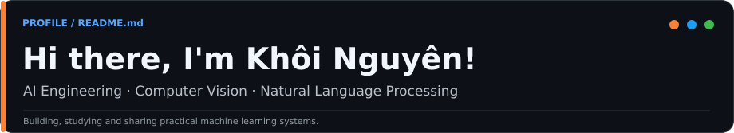
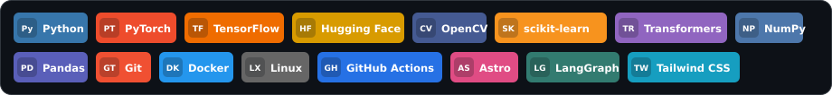
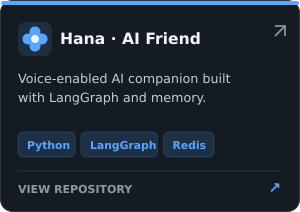
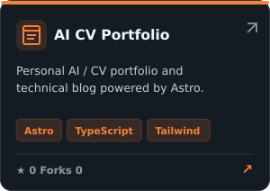
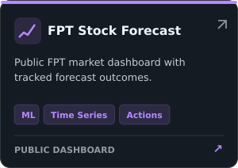
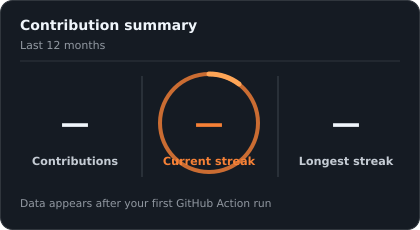
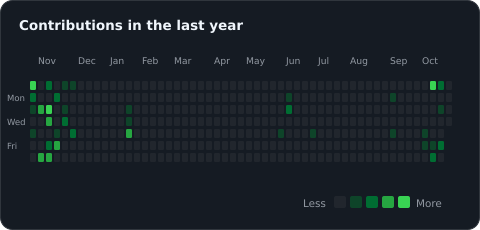

<!-- GitHub Profile README — custom designed for @nguyendao16 -->

  

### Tech Stack

### Featured Projects

<table>
  <tr>
    <td width="33%" align="center" valign="top">
      
    </td>
    <td width="33%" align="center" valign="top">
      
    </td>
    <td width="33%" align="center" valign="top">
      
    </td>
  </tr>
</table>

<a href="https://github.com/nguyendao16?tab=repositories">View all repositories →</a>

### My Recent Articles

<!-- ARTICLES:START -->
Explore my notes on machine learning, computer vision and NLP on the **[technical blog](https://nguyendao16.github.io/blog/)**. Published posts will be listed here automatically if found by the workflow.
<!-- ARTICLES:END -->

<a href="https://nguyendao16.github.io/blog/">View all posts →</a>

### My GitHub Contributions Summary

<table>
  <tr>
    <td width="46%" align="center" valign="top"></td>
    <td width="54%" align="center" valign="top"></td>
  </tr>
</table>

  <a href="https://nguyendao16.github.io/">Portfolio & Blog</a> &nbsp;·&nbsp;
  <a href="https://github.com/nguyendao16">GitHub</a> &nbsp;·&nbsp;
  <a href="mailto:daokhoinguyen.go@gmail.com">Email</a>

